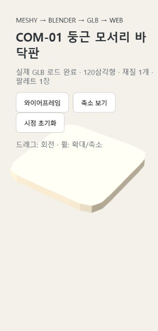

# AST-001 v001 — 첫 제작 흐름 베타

검수일: 2026-10-31 (Asia/Seoul)

## 결과

COM-01 바닥판으로 Meshy 생성 → Blender 후처리 → 팔레트 UV → GLB → 로컬 브라우저 표시를 실제 실행했다. 생산용 전체 파이프라인이나 Unity WebGL 빌드까지 검증했다는 의미는 아니다.

| 항목 | 실제 결과 |
|---|---|
| Meshy 작업 ID | 01a18d7c-b098-7005-b332-8069df276312 |
| 소비 크레딧 | 5 |
| 원본 삼각형 | 440 |
| 최종 삼각형 | 120 |
| 배치 수 / 장면 전체 | 1 / 120삼각형 |
| 재질 / 텍스처 | 1 / 1 |
| 팔레트 | v001, 2508×2508 PNG |
| GLB | 3,295,580바이트 |
| Blender | 5.2.4 LTS Release Candidate, 4f5026e99892 |
| 웹 | Codex 내장 브라우저, 로컬 HTTP, Three.js 0.180.0 |
| Unity 적용 / Unity WebGL 빌드 | 미수행·미검증 |

## 실제 발견한 문제와 처리

1. Meshy가 요청한 정사각형 대신 원형에 가까운 슬래브를 생성했다. 원본 정점을 지수 8의 초타원 형태로 변형하여 둥근 정사각형으로 교정했다.
2. 초기 변형 렌더에 모서리 틈이 있었다. 변형 정점의 볼록 외피를 재구성하고 평면을 정리했다. 최종 GLB 재가져오기에서 일치 정점을 용접한 기하학적 폐합 검사를 통과했다. 내보내기 노멀 분리 정점은 결함으로 오인하지 않도록 검사했다.
3. Windows에서 Meshy CLI가 다운로드 완료 후 종료 assertion을 출력했다. 파일 실재·GLB import로 성공을 확인했다.
4. 지정 포트 로컬 서버가 Windows 10013 오류를 냈다. OS가 배정하는 빈 IPv4 포트로 실행했다.
5. 좁은 웹 화면에서 모델 일부가 잘려 카메라 거리를 화면 비율에 맞추도록 수정했다. 재로드 후 전체 형태, 축소, 와이어프레임 표시를 확인했다.

## 팔레트 사용과 용량

원본 JPG 두 장을 디코딩한 픽셀을 보간 없이 보존했다. 2508×2508의 좌상단은 color1, 우상단은 color2이며 아래쪽은 동일 복사본이다. 대응표는 원본 512개 칸을 상단 위치로 연결한다. 원본과 합성본의 해당 영역을 픽셀 단위로 비교했다.

바닥판은 color1의 0부터 세는 행 13·열 0 중앙을 참조한다. color2 강조색은 이 소품에 필요하지 않아 사용하지 않았다. 공용 팔레트에는 다음 소품을 위해 포함한다. 모든 면 UV가 같은 중앙을 참조하며, GLB 재가져오기 후 UV 일치를 확인했다.

팔레트 PNG는 3,285,435바이트로 GLB 대부분을 차지한다. 따라서 현재 결과는 **흐름 검증 성공, 전송 용량 최적화는 후속 개선 대상**이다. 다음 개선안은 사용자와 방식 확정 후 원본 칸 중앙의 정확한 색상 샘플을 작은 아틀라스에 보존하는 것이다. 이번에는 원본 보존 방식을 임의로 바꾸지 않았다.

## 파일

- [Meshy 원본 기록](../../../meshy/models/original/AST-001/v001/README.md)
- [Blender 수정본](../../../meshy/models/blender/AST-001/v001/model.blend)
- [최종 GLB](../../../meshy/models/blender/AST-001/v001/exports/rounded-base.glb)
- [검수 JSON](../../../meshy/models/blender/AST-001/v001/inspection.json)
- [팔레트 PNG](../../../meshy/models/textures/palettes/v001/palette.png)
- [대응표](../../../meshy/models/textures/palettes/v001/mapping.json)
- [팔레트 구성 스크립트](../../../meshy/models/blender/AST-001/v001/processing/build_palette.py)
- [Blender 후처리 스크립트](../../../meshy/models/blender/AST-001/v001/processing/process_blender.py)
- [웹 미리보기 진입 파일](../../../meshy/models/blender/AST-001/v001/preview/index.html)

웹 미리보기는 저장소 루트를 로컬 HTTP로 서비스한 뒤 `/meshy/models/blender/AST-001/v001/preview/`에 접속한다. 파일 더블클릭 실행은 지원하지 않는다. Three.js 0.180.0 모듈과 MIT 라이선스는 preview/vendor/에 보관했다. Unity 빌드 목록에는 등록하지 않았다.

## 범위와 미검증

- 첫 베타 상태는 in_progress: 용량 개선과 사용자 외형 검토가 남아 있다.
- 브라우저 확대·축소 상태의 외형 확인은 수행했으나 실제 모바일 기기 성능·FPS·전체 사무실 조립은 미검증이다.
- Unity 프로젝트 및 WebGL 산출물은 만들지 않았다.
- GitHub 원격에는 아직 커밋·푸시하지 않았다.

## 전체 공간 제작 원장 조회 — v001

조회 시각: 2026-10-31T07:24:53.368067+09:00. 후보v004와 정식 조립/Unity 원장의 조회 결과다. 최신 revision만 현재 집계하며 과거/removed/프리팹 정의는 실제 장면 수량에 합산하지 않는다.

고정 모델: AST-001 v001 / COM-01 둥근 모서리 바닥판 베타. 등록 상태: `in_progress`. 최종 GLB: 120삼각형, 3295580바이트, 모델 재질1개·텍스처1개, 팔레트[2508, 2508].
최신 검수와 미검증 항목: [meshy/models/blender/AST-001/v001/inspection.json](../../../meshy/models/blender/AST-001/v001/inspection.json). 제작 방식/기록: 미등록 / 경로 미등록. 이 버전의 기록된 Meshy비용 미측정/미등록(null)크레딧은 과거 제작 비용과 이번 작업0크레딧을 구별한다. 모델별 토큰·금액 배분은 미측정이다.

### 전체 적용 후보 공간

| 후보 ID·원문 이름 | 정확한 공간 이름 | prompt | panorama | context | 연결 근거 | 계획 수량 |
|---|---|---|---|---|---|---|
| CND-001 둥근 바닥판 | 공용 업무 사무실 | PRM-001 v001 | PAN-001 v001 | office-shared-work v001 | 기준v003기획 | 미정 |
| CND-001 둥근 바닥판 | 협업·기획 사무실 | PRM-002 v001 | PAN-002 v001 | office-collaboration v001 | 기준v003기획 | 미정 |
| CND-001 둥근 바닥판 | 행정·문서 처리 사무실 | PRM-003 v001 | PAN-003 v001 | office-administration v001 | 기준v003기획 | 미정 |
| CND-001 둥근 바닥판 | 민원·방문객 접수실 | PRM-004 v001 | PAN-004 v001 | office-public-reception v001 | 기준v003기획 | 미정 |
| CND-001 둥근 바닥판 | 전문 상담 사무실 | PRM-005 v001 | PAN-005 v001 | office-professional-consultation v001 | 기준v003기획 | 미정 |
| CND-001 둥근 바닥판 | 실험실 | PRM-006 v001 | PAN-006 v001 | 미등록 | 기준v003기획 | 미정 |
| CND-001 둥근 바닥판 | 분석실 | PRM-007 v001 | PAN-007 v001 | 미등록 | 기준v003기획 | 미정 |
| CND-001 둥근 바닥판 | 진료실 | PRM-008 v001 | PAN-008 v001 | 미등록 | 기준v003기획 | 미정 |
| CND-001 둥근 바닥판 | 처치실 | PRM-009 v001 | PAN-009 v001 | 미등록 | 기준v003기획 | 미정 |
| CND-001 둥근 바닥판 | 병실 | PRM-010 v001 | PAN-010 v001 | 미등록 | 기준v003기획 | 미정 |
| CND-001 둥근 바닥판 | 의료 접수실 | PRM-011 v001 | PAN-011 v001 | 미등록 | 기준v003기획 | 미정 |
| CND-001 둥근 바닥판 | 교실 | PRM-012 v001 | PAN-012 v001 | 미등록 | 기준v003기획 | 미정 |
| CND-001 둥근 바닥판 | 교육 실습실 | PRM-013 v001 | PAN-013 v001 | 미등록 | 기준v003기획 | 미정 |
| CND-001 둥근 바닥판 | 강의실 | PRM-014 v001 | PAN-014 v001 | 미등록 | 기준v003기획 | 미정 |
| CND-001 둥근 바닥판 | 복지·심리 상담실 | PRM-015 v001 | PAN-015 v001 | 미등록 | 기준v003기획 | 미정 |
| CND-001 둥근 바닥판 | 복지 활동실 | PRM-016 v001 | PAN-016 v001 | 미등록 | 기준v003기획 | 미정 |
| CND-001 둥근 바닥판 | 요양실 | PRM-017 v001 | PAN-017 v001 | 미등록 | 기준v003기획 | 미정 |
| CND-001 둥근 바닥판 | 생산 구역 | PRM-018 v001 | PAN-018 v001 | 미등록 | 기준v003기획 | 미정 |
| CND-001 둥근 바닥판 | 조립 구역 | PRM-019 v001 | PAN-019 v001 | 미등록 | 기준v003기획 | 미정 |
| CND-001 둥근 바닥판 | 정비 구역 | PRM-020 v001 | PAN-020 v001 | 미등록 | 기준v003기획 | 미정 |
| CND-001 둥근 바닥판 | 소매점 | PRM-021 v001 | PAN-021 v001 | 미등록 | 기준v003기획 | 미정 |
| CND-001 둥근 바닥판 | 서비스 창구 | PRM-022 v001 | PAN-022 v001 | 미등록 | 기준v003기획 | 미정 |
| CND-001 둥근 바닥판 | 미용실 | PRM-023 v001 | PAN-023 v001 | 미등록 | 기준v003기획 | 미정 |
| CND-001 둥근 바닥판 | 주방 | PRM-024 v001 | PAN-024 v001 | 미등록 | 기준v003기획 | 미정 |
| CND-001 둥근 바닥판 | 제과실 | PRM-025 v001 | PAN-025 v001 | 미등록 | 기준v003기획 | 미정 |
| CND-001 둥근 바닥판 | 식당 홀 | PRM-026 v001 | PAN-026 v001 | 미등록 | 기준v003기획 | 미정 |
| CND-001 둥근 바닥판 | 디자인 작업실 | PRM-027 v001 | PAN-027 v001 | 미등록 | 기준v003기획 | 미정 |
| CND-001 둥근 바닥판 | 미술 작업실 | PRM-028 v001 | PAN-028 v001 | 미등록 | 기준v003기획 | 미정 |
| CND-001 둥근 바닥판 | 공예 작업실 | PRM-029 v001 | PAN-029 v001 | 미등록 | 기준v003기획 | 미정 |
| CND-001 둥근 바닥판 | 촬영 스튜디오 | PRM-030 v001 | PAN-030 v001 | 미등록 | 기준v003기획 | 미정 |
| CND-001 둥근 바닥판 | 방송 스튜디오 | PRM-031 v001 | PAN-031 v001 | 미등록 | 기준v003기획 | 미정 |
| CND-001 둥근 바닥판 | 영상 편집실 | PRM-032 v001 | PAN-032 v001 | 미등록 | 기준v003기획 | 미정 |
| CND-001 둥근 바닥판 | 공연 무대 | PRM-033 v001 | PAN-033 v001 | 미등록 | 기준v003기획 | 미정 |
| CND-001 둥근 바닥판 | 전시실 | PRM-034 v001 | PAN-034 v001 | 미등록 | 기준v003기획 | 미정 |
| CND-001 둥근 바닥판 | 문화 활동실 | PRM-035 v001 | PAN-035 v001 | 미등록 | 기준v003기획 | 미정 |
| CND-001 둥근 바닥판 | 건축 작업 구역 | PRM-036 v001 | PAN-036 v001 | 미등록 | 기준v003기획 | 미정 |
| CND-001 둥근 바닥판 | 설비 작업 구역 | PRM-037 v001 | PAN-037 v001 | 미등록 | 기준v003기획 | 미정 |
| CND-001 둥근 바닥판 | 환경 조사 지점 | PRM-038 v001 | PAN-038 v001 | 미등록 | 기준v003기획 | 미정 |
| CND-001 둥근 바닥판 | 관측 지점 | PRM-039 v001 | PAN-039 v001 | 미등록 | 기준v003기획 | 미정 |
| CND-001 둥근 바닥판 | 재배지 | PRM-040 v001 | PAN-040 v001 | 미등록 | 기준v003기획 | 미정 |
| CND-001 둥근 바닥판 | 온실 | PRM-041 v001 | PAN-041 v001 | 미등록 | 기준v003기획 | 미정 |
| CND-001 둥근 바닥판 | 축사 | PRM-042 v001 | PAN-042 v001 | 미등록 | 기준v003기획 | 미정 |
| CND-001 둥근 바닥판 | 동물 관리실 | PRM-043 v001 | PAN-043 v001 | 미등록 | 기준v003기획 | 미정 |
| CND-001 둥근 바닥판 | 선박 갑판 | PRM-044 v001 | PAN-044 v001 | 미등록 | 기준v003기획 | 미정 |
| CND-001 둥근 바닥판 | 조타실 | PRM-045 v001 | PAN-045 v001 | 미등록 | 기준v003기획 | 미정 |
| CND-001 둥근 바닥판 | 부두 | PRM-046 v001 | PAN-046 v001 | 미등록 | 기준v003기획 | 미정 |
| CND-001 둥근 바닥판 | 체육관 | PRM-047 v001 | PAN-047 v001 | 미등록 | 기준v003기획 | 미정 |
| CND-001 둥근 바닥판 | 운동 지도실 | PRM-048 v001 | PAN-048 v001 | 미등록 | 기준v003기획 | 미정 |
| CND-001 둥근 바닥판 | 경기 구역 | PRM-049 v001 | PAN-049 v001 | 미등록 | 기준v003기획 | 미정 |
| CND-001 둥근 바닥판 | 수사실 | PRM-050 v001 | PAN-050 v001 | 미등록 | 기준v003기획 | 미정 |
| CND-001 둥근 바닥판 | 증거 분석실 | PRM-051 v001 | PAN-051 v001 | 미등록 | 기준v003기획 | 미정 |
| CND-001 둥근 바닥판 | 법정 | PRM-052 v001 | PAN-052 v001 | 미등록 | 기준v003기획 | 미정 |
| CND-001 둥근 바닥판 | 물류 창고 | PRM-053 v001 | PAN-053 v001 | 미등록 | 기준v003기획 | 미정 |
| CND-001 둥근 바닥판 | 운송 조종 공간 | PRM-054 v001 | PAN-054 v001 | 미등록 | 기준v003기획 | 미정 |
| CND-001 둥근 바닥판 | 운송 거점 | PRM-055 v001 | PAN-055 v001 | 미등록 | 기준v003기획 | 미정 |
| CND-001 둥근 바닥판 | 금융 창구 | PRM-056 v001 | PAN-056 v001 | 미등록 | 기준v003기획 | 미정 |
| CND-001 둥근 바닥판 | 금융 상담실 | PRM-057 v001 | PAN-057 v001 | 미등록 | 기준v003기획 | 미정 |
| CND-001 둥근 바닥판 | 가정 수리 공간 | PRM-058 v001 | PAN-058 v001 | 미등록 | 기준v003기획 | 미정 |
| CND-001 둥근 바닥판 | 방문 학습 공간 | PRM-059 v001 | PAN-059 v001 | 미등록 | 기준v003기획 | 미정 |
| CND-001 둥근 바닥판 | 서버실 | PRM-060 v001 | PAN-060 v001 | 미등록 | 기준v003기획 | 미정 |
| CND-001 둥근 바닥판 | 관제실 | PRM-061 v001 | PAN-061 v001 | 미등록 | 기준v003기획 | 미정 |
| CND-001 둥근 바닥판 | 거실 | PRM-062 v001 | PAN-062 v001 | 미등록 | 기준v003기획 | 미정 |
| CND-001 둥근 바닥판 | 주택 관리 공간 | PRM-063 v001 | PAN-063 v001 | 미등록 | 기준v003기획 | 미정 |
| CND-001 둥근 바닥판 | 군 행정실 | PRM-065 v001 | PAN-065 v001 | 미등록 | 기준v003기획 | 미정 |
| CND-001 둥근 바닥판 | 생활관 | PRM-066 v001 | PAN-066 v001 | 미등록 | 기준v003기획 | 미정 |
| CND-001 둥근 바닥판 | 장비 관리실 | PRM-067 v001 | PAN-067 v001 | 미등록 | 기준v003기획 | 미정 |
| CND-001 둥근 바닥판 | 출장 업무 공간 | PRM-068 v001 | PAN-068 v001 | 미등록 | 기준v003기획 | 미정 |
| CND-001 둥근 바닥판 | 안내 집결 지점 | PRM-069 v001 | PAN-069 v001 | 미등록 | 기준v003기획 | 미정 |
| CND-001 둥근 바닥판 | 기독교(개신교) 예배실 — 목사 | PRM-064 v002 | PAN-064 v001 | 미등록 | 기준v003기획 | 미정 |
| CND-001 둥근 바닥판 | 불교 법당 — 스님 | PRM-070 v001 | PAN-070 v001 | 미등록 | 기준v003기획 | 미정 |
| CND-001 둥근 바닥판 | 천주교 성당 — 신부님 | PRM-071 v001 | PAN-071 v001 | 미등록 | 기준v003기획 | 미정 |

### 실제 Blender/GLB 조립 사용

| 조립 ID·revision | 현재/과거 | 고정 조립 모델 | 수량·범위 | 근거 |
|---|---|---|---|---|
| 실제 조립 사용 이력 미등록/미검증 | 미확인 | 미등록 | 미정 | 원장 조회 결과 |

### 실제 Unity 사용·빌드·실행

| usage ID·revision | 현재/과거·상태·종류 | 프로젝트 | 장면/프리팹 | 수량 | 빌드 포함 | 실행 검수·근거 |
|---|---|---|---|---|---|---|
| 실제 Unity 사용 이력 미등록/미검증 | 미확인 | 미등록 | 미등록 | 미정 | 미등록 | 미검증 |

Unity 단일 원장: [docs/machine/catalog/asset-usages.json](../../machine/catalog/asset-usages.json). 조립 단일 원장: [docs/machine/catalog/scene-assemblies.json](../../machine/catalog/scene-assemblies.json). 각 ID/revision의 instances·transform·evidence는 해당 정식 원장에서 조회한다. 프리팹 quantity:null은 수량0이 아니며 장면 배치가 아니다.

### 실제 검수 범위와 한계

각 고정 inspection과 대상 빌드의 실제 근거를 따른다. 과거 pass는 새 모델·빌드에 승계하지 않는다. Native -nographics, HTTP 공간 탐색, 직접 작업/통신, 다른 장치/브라우저의 미검증 범위를 구별한다.
