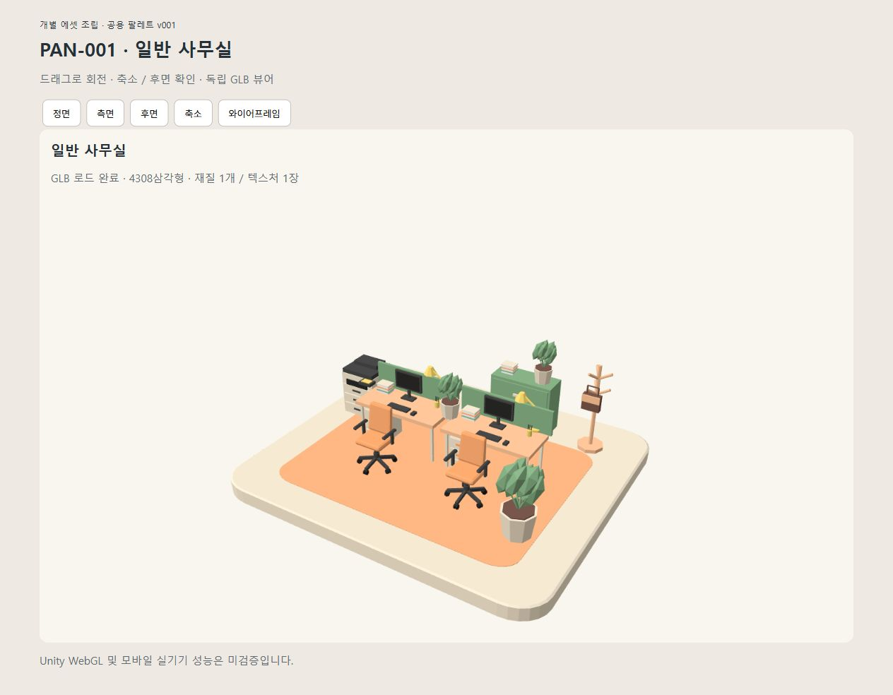

# PAN-001 일반 사무실 제작·조립 v001

참조: panoramas.json PAN-001 v001, A-basic-office-v2.png를 직접 확인. 참고 이미지는 구도 기준이며 실제 치수 도면이 아니다. 다른 파노라마 제작·직업 검증·기획 승인 상태 변경은 포함하지 않는다.

## 작업표 및 장면 예산
|구분|대상|배치 수|방식 / 예상 삼각형 합계|
|---|---|---:|---|
|재사용|AST-001 v002 바닥판|1|장면에서 크기 변경 / 220|
|재사용|AST-002 v001 주황 표면|1|장면에서 매트로 크기 변경 / 108|
|재사용|AST-003 v001 의자|2|기존 주황색 그대로 / 1584|
|신규|책상·모니터·키보드·마우스·하부서랍·스크린·스탠드·펜꽂이|각2|Blender 기본 도형 / 약1500|
|신규|책 묶음|3|반복 재사용 / 약220|
|신규|화분|3|잎 저면수 도형 / 약750|
|신규|복합기·뒤 수납장·옷걸이·가방|각1|Blender / 약500|

형상 수정 또는 색상 변형 없이 기존 버전을 배치한다. 변환은 placements.json에 남긴다. 신규 형상은 기존 박스·원통 제작 패턴 및 공용 팔레트 UV 방식을 재사용한다. Meshy 신규 호출 0회 / 0크레딧. 과거 의자 비교의 유료 비용은 이번 비용에 포함하지 않는다.

## 전달 및 검수
제작·조립 및 독립 웹 검수를 수행했다. Unity 항목은 미검증이며 에셋 상태는 in_progress를 유지했다.
Unity 프로젝트 조사: unity/projects에는 .gitkeep만 있으며 Assets/Packages/ProjectSettings가 없다. 기존 프로젝트가 없으므로 Unity 장면·WebGL·ZIP은 생성하지 않는다. 독립 GLB 웹 검수는 별도로 수행한다. Unity 전환 시 프로젝트 및 사용할 Editor 버전, WebGL Build Support 모듈, GLB 임포터/팔레트 재질 설정이 필요하다.

기존 사용 이력 계약의 placed는 Unity 전용이므로 Blender 실제 배치를 placed로 오기록하지 않는다. 장면의 placements.json을 실제 비Unity 배치 원장으로 사용하고 catalog에 별도 색인을 남긴다.

## 최종 실측

|에셋|버전|개당 삼각형|배치 수|합계|
|---|---|---:|---:|---:|
|COM-01 둥근 모서리 바닥판 — Blender 직접 제작 (AST-001)|v002|220|1|220|
|COM-02 바닥 표면 — Blender 직접 제작 (AST-002)|v001|108|1|108|
|COM-04 회전 사무의자 — blender_direct (AST-003)|v001|792|2|1584|
|업무 책상 (AST-004)|v001|60|2|120|
|모니터 (AST-005)|v001|48|2|96|
|키보드 (AST-006)|v001|12|2|24|
|마우스 (AST-007)|v001|12|2|24|
|책상 아래 서랍장 (AST-008)|v001|84|2|168|
|복합기 (AST-009)|v001|144|1|144|
|화분 (AST-010)|v001|308|3|924|
|책 묶음 (AST-011)|v001|72|3|216|
|펜꽂이 (AST-012)|v001|76|2|152|
|낮은 책상 스크린 (AST-013)|v001|12|2|24|
|관절 스탠드 (AST-014)|v001|96|2|192|
|뒤쪽 수납장 (AST-015)|v001|60|1|60|
|옷걸이 (AST-016)|v001|168|1|168|
|업무용 가방 (AST-017)|v001|84|1|84|

총 17종, 30개 배치, **4308삼각형**. 신규 개별 에셋 14종 + 기존 3종 재사용. 조립 부모는 중복 합산하지 않았다. 재질 1개, 텍스처 1장, 팔레트 2508×2508, GLB **3,600,680바이트**. Meshy 이번 소비 0크레딧.

## 실제 검수 및 남은 사항
- 각 신규 GLB와 전체 GLB를 Blender에 다시 불러와 삼각형·재질·텍스처 수·팔레트 UV 중앙 참조를 검사했다. 개별 소품 최대 792삼각형, 장면 목표 통과.
- 웹에서 4,308삼각형 로딩, 정면·후면·축소 상태를 직접 확인했다. 단색 경계에 눈에 띄는 번짐이나 누락 텍스처는 없었다. 실제 프레임 시간·모바일 성능은 측정하지 않았다.
- 키보드 키·마우스 곡면·가구 베벨은 단순화했다. 색은 기존 파스텔 팔레트로 참고 이미지보다 부드럽다. 의자의 실제 팔걸이 색은 기존 버전을 유지했다.
- 책상 2개를 이어 배치하고, 스크린·스탠드 각 2개로 업무석을 구성했다. 참고 이미지의 픽셀 단위 복제나 후면의 보이지 않는 구조 복원은 하지 않았다.
- 공용 팔레트 원본 전체 보존으로 약 3.6MB 중 대부분이 팔레트다. 향후 별도 승인된 팔레트 최적화 검토 가능.
- 신규 색상 변형 없음. 기존 GLB·팔레트·기획 및 직업 검증/승인 상태를 보존했다. 커밋·푸시 없음.

## 결과물 및 원장
- [전체 Blender](../../../meshy/models/blender/AST-020/v001/model.blend)
- [전체 GLB](../../../meshy/models/blender/AST-020/v001/exports/model.glb)
- [개별 에셋 catalog](../../machine/catalog/assets.json): AST-004~AST-017 v001의 원본·Blender·GLB·미리보기·검수 경로.
- [실제 비Unity 조립 이력](../../machine/catalog/scene-assemblies.json), [인스턴스 변환](../../../meshy/models/blender/AST-020/v001/placements.json). 기존 Unity asset-usages의 placed 계약을 변경하지 않았다.
- [공용 팔레트 대응표](../../../meshy/models/textures/palettes/v001/mapping.json)
- [제작·조립 스크립트](../../../meshy/models/blender/AST-020/v001/processing/build_office.py): COL에 신규 부품별 팔레트 칸 참조, place에 실제 변환 기록.
- [검수 기록](../../../meshy/models/blender/AST-020/v001/inspection.json)
- [웹 보기](http://127.0.0.1:61628/meshy/models/blender/AST-020/v001/preview/)

