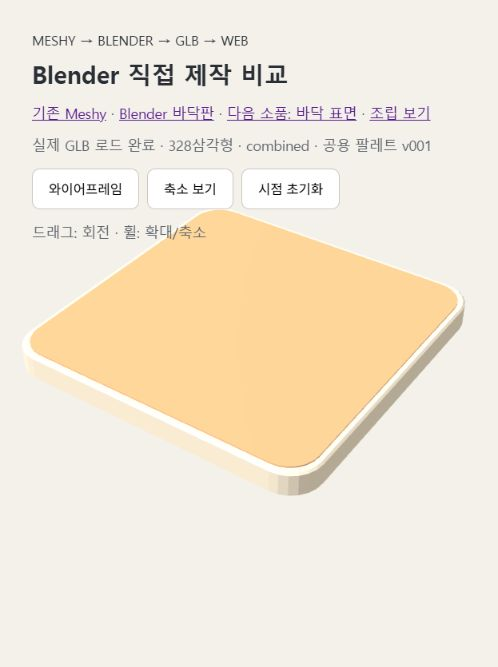

# 단순 소품 제작 비교 — Blender 직접 제작

날짜: 2026-10-31. 사용자 지시에 따라 단순 형상은 에이전트가 제작 비용과 수정 부담을 판단해 Blender를 우선 선택한다.

## 실행 결과

| 항목 | 기존 바닥판 | 직접 제작 바닥판 | 다음 소품: 바닥 표면 |
|---|---|---|---|
| 등록 | AST-001 v001 | AST-001 v002 | AST-002 v001 |
| 방법 | Meshy 생성 후 Blender 교정 | Blender 파라미터 모델링 | 같은 생성 함수 재사용 |
| 최종 삼각형 | 120 | 220 | 108 |
| Meshy 크레딧 | 5 | 0 | 0 |
| GLB 바이트 | 3,295,580 | 3,300,688 | 3,292,904 |
| 형태 | 원형 결과를 정사각형으로 교정 | 동일 반경 네 모서리 + 얇은 가장자리 베벨 | 둥근 직사각형, 얇은 두께 |
| 생성·저장·재검수 실행 시간 | 동일 조건 측정 없음 | 약 0.70초 | 약 0.42초 |

시간은 Blender 스크립트 내부에서 측정한 렌더 전 구간이다. 스크립트 작성, 도구 호출, Blender 시작, 미리보기 렌더, 웹 검수 시간은 포함하지 않는다. 모델별 토큰 사용량은 측정할 수 없어 수치 비교하지 않았다.

## 판단

이 두 소품은 Blender 직접 제작이 적합하다. 형상이 수치로 명확하고, 원본 생성 대기와 결과 교정을 생략하며 같은 함수의 크기·반경·높이만 바꿔 재사용할 수 있다. 면 수만 줄이는 것이 목적은 아니다. 직접 바닥판은 가장자리 베벨 때문에 100삼각형 더 많지만 전체 상한 1,000보다 충분히 낮으며 형태가 일정하다.

향후 바닥판·표면·상자·단순 책상·책·선반은 Blender 우선, 복잡한 유기적 캐릭터·조형물은 Meshy의 이점과 후처리 부담을 판단해 선택한다. 이 규칙을 AGENTS.md에 반영했다.

## 팔레트와 웹 검증

- 기존 공용 팔레트 v001을 그대로 사용하여 도구 차이만 비교했다.
- 바닥판은 color1 행 13·열 0, 표면은 color1 행 3·열 5(모두 0부터 세는 좌표)를 UV로 참조한다. color2는 불필요하여 사용하지 않았다.
- 최종 GLB를 Blender에서 다시 열어 면 수, 닫힌 형상, 단일 재질·텍스처, UV 중앙 좌표를 확인했다.
- 웹에서 직접 바닥판 220삼각형과 두 소품 조립 328삼각형 표시를 확인했다.
- 조립 시 표면을 Z=0.16m에 놓는다(웹 glTF 좌표에서는 Y). 표면 자체 높이는 0.008m이며 바닥판과 겹치는 윗면 깜빡임을 방지한다.
- 조립 미리보기에서 공용 재질 객체도 공유한다. 개별 GLB마다 PNG가 내장되어 전송 용량 중복은 남아 있다.
- 3.3MB 수준의 파일 크기는 팔레트 원본 전체 보존 방식 때문이며, Blender 직접 제작만으로 해결되지 않는다.

## 산출물

- [바닥판 Blender](../../../meshy/models/blender/AST-001/v002/model.blend)
- [바닥판 GLB](../../../meshy/models/blender/AST-001/v002/exports/model.glb)
- [바닥 표면 Blender](../../../meshy/models/blender/AST-002/v001/model.blend)
- [바닥 표면 GLB](../../../meshy/models/blender/AST-002/v001/exports/model.glb)
- [재사용 제작 스크립트](../../../meshy/models/blender/AST-001/v002/processing/build_direct.py)
- [비교 뷰어](../../../meshy/models/blender/AST-001/v002/preview/index.html)

원본과 기존 v001은 유지했다. Unity 적용·모바일 실기기 성능·GitHub 푸시는 수행하지 않았다. 팔레트 전송 용량과 외형 최종 검토가 남아 in_progress로 등록했다.

