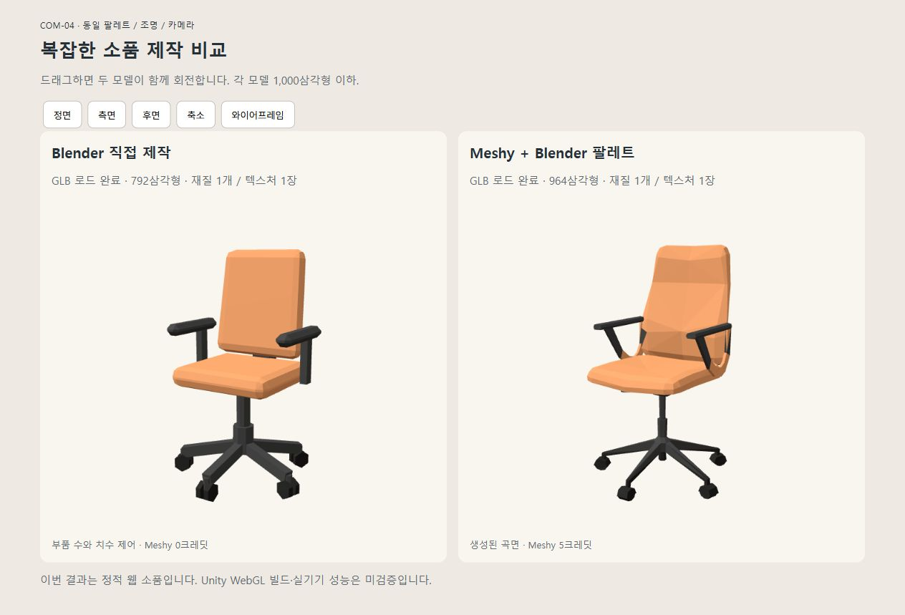

# 복잡한 소품 비교 — COM-04 회전 사무의자

실행·검수일: 2026-10-31 (Asia/Seoul)

## 선정 이유와 공통 조건

저장소 사무실 에셋 목록에서 COM-04를 선정했다. 좌판·굽은 등받이·팔걸이·중앙 기둥·5갈래 받침대·바퀴로 구성되어 바닥판보다 복잡하며, 정확한 반복 구조와 곡면 외형을 함께 비교할 수 있다. 외부 에셋을 검색하거나 내려받아 대신 사용하지 않았다.

동일 요구사항: 둥근 쿠션, 두 팔걸이, 중앙 기둥, 5갈래 받침대와 끝마다 바퀴 한 쌍, 헤드레스트 없음. 각 버전 1,000삼각형 이하. 같은 color1 팔레트 칸·재질 설정·조명·카메라를 사용했다. 두 방식은 같은 디자인 요구를 구현한 서로 다른 모델이며, 동일 메시나 동일 실루엣의 품질 시험은 아니다. 한 사례로 모든 복잡한 모델에 일반화하지 않는다.

## 측정 결과

| 항목 | Blender 직접 제작 | Meshy + Blender 후처리 |
|---|---|---|
| 등록 | AST-003 v001 | AST-003 v002 |
| 최종 삼각형 | 792 | 964 |
| 요청 면 수 | 생성 구조로 결정 | 900 요청, 실제 964 |
| Meshy 생성 횟수 | 0 | 1 |
| 실제 크레딧 | 0 | 5 |
| GLB 바이트 | 3,343,932 | 3,385,072 |
| 재질 / 이미지 | 1 / 1 | 1 / 1 |
| 원본 | 편집 가능한 부품별 source.blend | Meshy model.glb 보존 |
| 최종 GLB 재가져오기 | 통과 | 통과 |
| 팔레트 UV | 통과 | 통과 |
| 기하학적 경계·비매니폴드 에지 | 0 / 0 | 0 / 0 |
| 웹 로딩·후면·축소 표시 | 확인 | 확인 |

기하학적 검사는 노멀 분리로 중복된 정점을 1e-6m 허용치로 임시 용접한 뒤 수행했다. 부품 사이의 의도적인 교차나 스킨 변형 적합성을 검사한 것은 아니다. 정적 웹용 소품 기준이다.

## 실제 제작 부담과 관찰

### Blender

- 박스 베벨·원통·연결 막대 함수로 직접 구성했다. 반복 부품은 루프로 생성했다.
- 받침대 5개와 바퀴 10개를 명시적으로 구성할 수 있다.
- 쿠션·프레임·바퀴 역할을 제작 시점부터 지정해 UV 색상 분류가 명확했다.
- 기계적으로 일정하고 수정하기 쉽지만, 등받이·좌판은 Meshy 결과보다 단순하고 각진 인상이다.
- 렌더 이전 생성·저장·재검수 실행 구간 약 1.221초. 스크립트 작성·시작·렌더·웹 검수 시간은 제외한다.

### Meshy

- text-to-3d / smart-topology / meshy-t2 / geometry-only 요청 1회로 의자 형태가 나왔다.
- 작업 ID: `01a18d94-c632-712e-8a51-dae08377d38e`.
- 작업 기록상 서버 생성 구간 약 8.64초. 네트워크·다운로드·스크립트 작성·검수 시간은 제외한다.
- Blender 후처리는 높이 1.15m 정규화, 방향 통일, 팔레트 UV 적용이다. 면 수를 줄이기 위한 유료 재생성이나 별도 Remesh는 하지 않았다.
- 등받이 곡면과 좌판으로 이어지는 외형, 조절 레버가 자연스럽게 생성됐다.
- 바퀴는 작은 덩어리로 단순화되어 요청한 바퀴 쌍을 명확하게 구분하기 어렵다.
- 원본에 의미별 부품 이름이 없어 위치 기반으로 쿠션·프레임·바퀴를 분류했다. 첫 적용에서 팔걸이 일부가 쿠션색이 되어 분류를 한 차례 수정했다.
- UV는 승인된 팔레트 칸만 참조하지만 팔걸이와 쿠션 연결부의 정확한 색 경계는 수작업 정리가 더 필요하다. ‘UV 좌표 유효’와 ‘디자인 색상 경계 완성’은 구분한다.
- 최종 후처리 실행 구간 약 1.076초. 첫 시도와 수정·렌더·검수의 총 작업 시간은 아니다.

실제 토큰 사용량과 사람의 제작 시간은 측정하지 않았다. 따라서 몇 배 효율적이라는 수치는 제시하지 않는다.

## 판단과 작업 분담 보완

이번 사무실용 1,000삼각형 예산에서 **회전 의자는 Blender 직접 제작을 기본 채택**하는 편이 낫다. 172삼각형 적고, 원하는 부품 수·치수·색 구분을 통제하며 변형을 재사용하기 쉽다.

다만 곡면 외형만 비교하면 Meshy 결과가 더 자연스러운 부분이 있다. 조형적 등받이를 요구한다면 Meshy의 쿠션·등받이를 활용하고 받침대·바퀴·팔걸이는 Blender로 만드는 혼합 방식이 후속 후보이다. 이 혼합 모델은 이번에 제작하지 않았다.

지침 보완: ‘소품이 복잡해 보인다’가 아니라 **반복·대칭·정확한 구조가 많은지, 자유로운 곡면이 핵심인지**로 판단한다. 복잡한 구조물도 매개변수로 정의할 수 있으면 Blender가 유리할 수 있다.

## 파일과 미검증 범위

- [Blender 직접 제작 원본](../../../meshy/models/original/AST-003/v001/source.blend)
- [Blender 직접 제작 GLB](../../../meshy/models/blender/AST-003/v001/exports/model.glb)
- [Meshy 원본](../../../meshy/models/original/AST-003/v002/model.glb)
- [Meshy 후처리 GLB](../../../meshy/models/blender/AST-003/v002/exports/model.glb)
- [공통 제작·후처리 스크립트](../../../meshy/models/blender/AST-003/v001/processing/compare_chair.py)
- [비교 웹 페이지](../../../meshy/models/blender/AST-003/v001/preview/index.html)

팔레트는 v001을 그대로 사용했다. color1의 쿠션 (3,7), 프레임 (15,12), 바퀴 (15,14), 좌표는 0부터 시작한다. color2는 필요하지 않아 사용하지 않았다. 각 GLB의 약 3.3MB는 대부분 원본 전체를 보존한 팔레트 때문이다.

두 버전은 베타 in_progress로 등록했다. Unity 적용·Unity WebGL 빌드·모바일 실기기·리깅은 미검증이다. GitHub 푸시하지 않았다. 원본 라이선스와 사용자 팔레트 사용 조건을 별도 추정하지 않는다.

