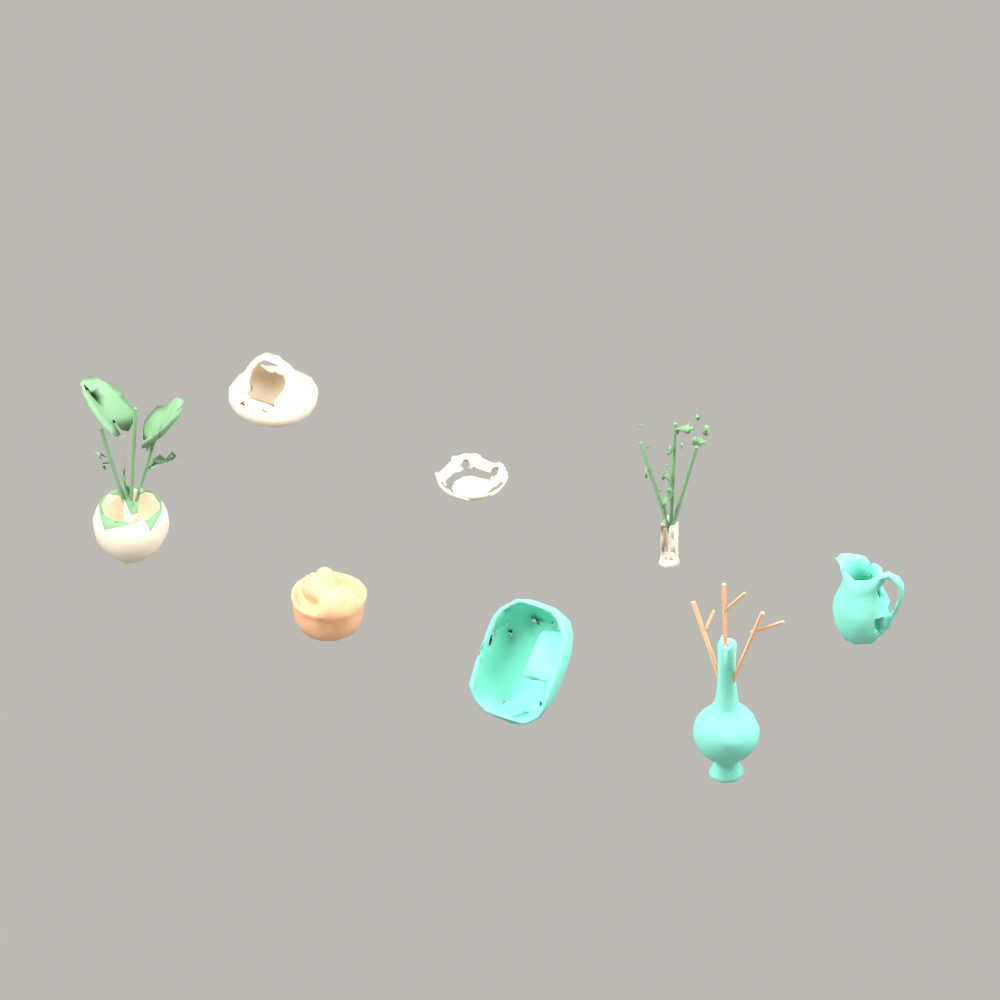

# 공용 공간 장식 소품 분리 라이브러리 v001

한 Meshy 장면 → Blender 연결 성분 확인 →8개 개별 원본/수정본/GLB/FBX. 묶음 실제20크레딧, 개별 비용 배분 미측정. 현재 라이브러리 소품은 실제 공간에 배치하지 않았으며 잎·가지의 가는 형상과 그릇 가장자리 등 추가 디테일 검수 및 실제 웹 검증이 남아 있다. `ready`가 아니다.

| 후보·고정 모델 | 소품 | 실측 삼각형 | 전체 적용 후보 공간 |
|---|---|---:|---|
| CND-269 / AST-3007 v001 | 넓은 잎 화분 | 552 | 전문 상담 사무실 / PRM-005 v001 / PAN-005 v001 / context 미등록; 복지·심리 상담실 / PRM-015 v001 / PAN-015 v001 / context 미등록; 복지 활동실 / PRM-016 v001 / PAN-016 v001 / context 미등록; 소매점 / PRM-021 v001 / PAN-021 v001 / context 미등록; 미용실 / PRM-023 v001 / PAN-023 v001 / context 미등록; 식당 홀 / PRM-026 v001 / PAN-026 v001 / context 미등록; 디자인 작업실 / PRM-027 v001 / PAN-027 v001 / context 미등록; 문화 활동실 / PRM-035 v001 / PAN-035 v001 / context 미등록; 기독교(개신교) 예배실 — 목사 / PRM-064 v002 / PAN-064 v001 / context 미등록 |
| CND-270 / AST-3008 v001 | 짜임 바구니 | 510 | 복지 활동실 / PRM-016 v001 / PAN-016 v001 / context 미등록; 요양실 / PRM-017 v001 / PAN-017 v001 / context 미등록; 소매점 / PRM-021 v001 / PAN-021 v001 / context 미등록; 식당 홀 / PRM-026 v001 / PAN-026 v001 / context 미등록; 문화 활동실 / PRM-035 v001 / PAN-035 v001 / context 미등록; 거실 / PRM-062 v001 / PAN-062 v001 / context 미등록; 생활관 / PRM-066 v001 / PAN-066 v001 / context 미등록 |
| CND-271 / AST-3009 v001 | 접어 세운 패브릭 | 510 | 병실 / PRM-010 v001 / PAN-010 v001 / context 미등록; 요양실 / PRM-017 v001 / PAN-017 v001 / context 미등록; 미용실 / PRM-023 v001 / PAN-023 v001 / context 미등록; 거실 / PRM-062 v001 / PAN-062 v001 / context 미등록; 생활관 / PRM-066 v001 / PAN-066 v001 / context 미등록 |
| CND-272 / AST-3010 v001 | 가지 장식 꽃병 | 606 | 전문 상담 사무실 / PRM-005 v001 / PAN-005 v001 / context 미등록; 복지·심리 상담실 / PRM-015 v001 / PAN-015 v001 / context 미등록; 미용실 / PRM-023 v001 / PAN-023 v001 / context 미등록; 디자인 작업실 / PRM-027 v001 / PAN-027 v001 / context 미등록; 미술 작업실 / PRM-028 v001 / PAN-028 v001 / context 미등록; 공예 작업실 / PRM-029 v001 / PAN-029 v001 / context 미등록; 문화 활동실 / PRM-035 v001 / PAN-035 v001 / context 미등록 |
| CND-273 / AST-3011 v001 | 고리형 조형 소품 | 508 | 복지·심리 상담실 / PRM-015 v001 / PAN-015 v001 / context 미등록; 디자인 작업실 / PRM-027 v001 / PAN-027 v001 / context 미등록; 미술 작업실 / PRM-028 v001 / PAN-028 v001 / context 미등록; 공예 작업실 / PRM-029 v001 / PAN-029 v001 / context 미등록; 문화 활동실 / PRM-035 v001 / PAN-035 v001 / context 미등록 |
| CND-274 / AST-3012 v001 | 얕은 도자기 그릇 | 510 | 식당 홀 / PRM-026 v001 / PAN-026 v001 / context 미등록; 공예 작업실 / PRM-029 v001 / PAN-029 v001 / context 미등록; 거실 / PRM-062 v001 / PAN-062 v001 / context 미등록; 생활관 / PRM-066 v001 / PAN-066 v001 / context 미등록 |
| CND-275 / AST-3013 v001 | 잎 가지 꽃병 | 556 | 복지·심리 상담실 / PRM-015 v001 / PAN-015 v001 / context 미등록; 미용실 / PRM-023 v001 / PAN-023 v001 / context 미등록; 식당 홀 / PRM-026 v001 / PAN-026 v001 / context 미등록; 문화 활동실 / PRM-035 v001 / PAN-035 v001 / context 미등록; 기독교(개신교) 예배실 — 목사 / PRM-064 v002 / PAN-064 v001 / context 미등록 |
| CND-276 / AST-3014 v001 | 곡선 손잡이 피처 | 510 | 식당 홀 / PRM-026 v001 / PAN-026 v001 / context 미등록; 공예 작업실 / PRM-029 v001 / PAN-029 v001 / context 미등록; 거실 / PRM-062 v001 / PAN-062 v001 / context 미등록; 생활관 / PRM-066 v001 / PAN-066 v001 / context 미등록 |

실제 사용 이력:8개 모두 배치 미등록/미검증. 후보 수량 미정. 원장 `docs/machine/catalog/spatial-detail-packs.json`, 개별 명세는 각 AST 문서·inspection.json.

<!-- spatial-diversity-v011 -->
## 이번 공간 보강의 실제 재사용 갱신

이전8종은 분리 라이브러리였으며, v010 및 최종 v011에서 실제로 사용한 고정 버전만 조립·Unity·build 원장에 추가했다. 원본 과거20크레딧과 이번 재사용0을 구분한다.

- AST-3007 v001 — 실제 사용 참조 0건; 세부 수량/장면/현재·과거는 해당 AST 명세 및 원장 조회.
- AST-3008 v001 — 실제 사용 참조 9건; 세부 수량/장면/현재·과거는 해당 AST 명세 및 원장 조회.
- AST-3009 v001 — 실제 사용 참조 0건; 세부 수량/장면/현재·과거는 해당 AST 명세 및 원장 조회.
- AST-3010 v001 — 실제 사용 참조 25건; 세부 수량/장면/현재·과거는 해당 AST 명세 및 원장 조회.
- AST-3011 v001 — 실제 사용 참조 0건; 세부 수량/장면/현재·과거는 해당 AST 명세 및 원장 조회.
- AST-3012 v001 — 실제 사용 참조 0건; 세부 수량/장면/현재·과거는 해당 AST 명세 및 원장 조회.
- AST-3013 v001 — 실제 사용 참조 0건; 세부 수량/장면/현재·과거는 해당 AST 명세 및 원장 조회.
- AST-3014 v001 — 실제 사용 참조 9건; 세부 수량/장면/현재·과거는 해당 AST 명세 및 원장 조회.
